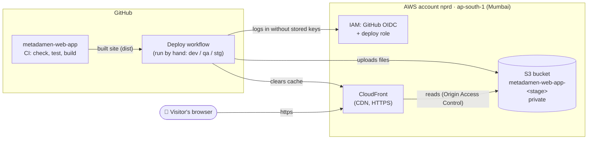
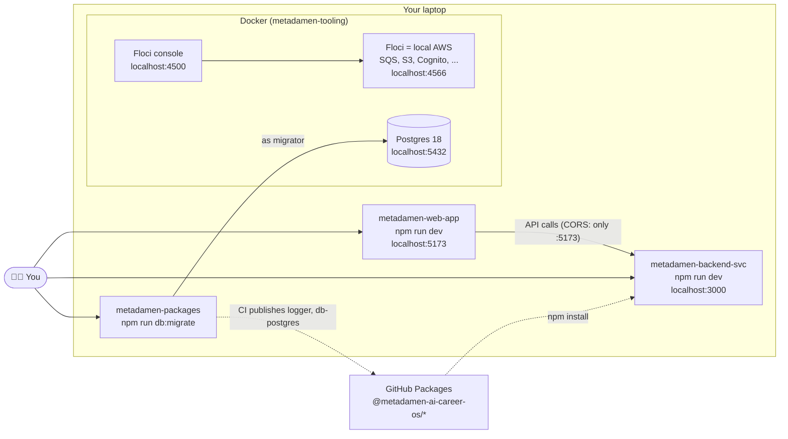
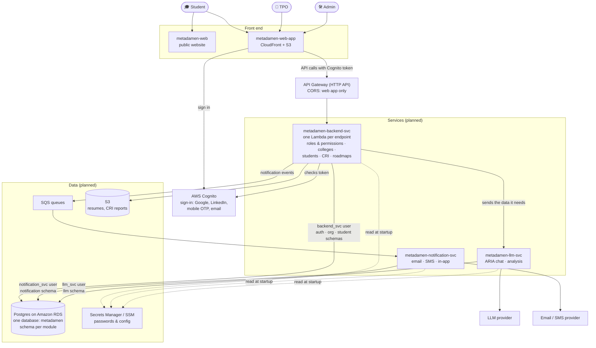
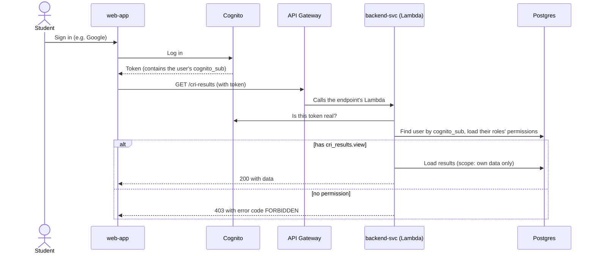

# Architecture

How the pieces of Metadamen fit together: **what runs today**, and **what we are building next**.

> This page shows the system as of **2026-10-17**. Anything marked _planned_ is agreed but not built, and details may change.

---

## Repositories

All repos live in the GitHub organization [`metadamen-ai-career-os`](https://github.com/metadamen-ai-career-os).

| Repo | What it is | Tech | Status |
|---|---|---|---|
| `metadamen-web-app` | The signed-in app for Students, TPOs and Admins | React, TypeScript, Vite | ✅ Skeleton, deployed to AWS |
| `metadamen-infra` | AWS infrastructure as code | AWS CDK (TypeScript) | ✅ Web hosting + GitHub deploy access |
| `metadamen-tooling` | Local development environment | Docker Compose: Postgres 18, Floci (local AWS) | ✅ Done |
| `metadamen-packages` | Shared libraries + database migrations | TypeScript, npm workspaces, Changesets | ✅ `logger`, `db-postgres` published |
| `metadamen-engineering-docs` | These docs | Markdown | ✅ Started |
| `metadamen-backend-svc` | Main API: sign-in, roles, colleges, students, CRI, roadmaps | TypeScript, AWS Lambda, Express for local dev | 🟡 Started: `GET /health`, response format, error codes. Not on AWS yet |
| `metadamen-notification-svc` | Sends email / SMS / in-app notifications | Node.js, TypeScript | 🔜 Planned |
| `metadamen-llm-svc` | AI features: ARIA chat, analysis | Node.js, TypeScript | 🔜 Planned |
| `metadamen-web` | Public marketing website | — | 🔜 Planned |

---

## Today: on AWS

Only the web app is live. It's a static site: the backend and database aren't on AWS yet.

| Environment | Purpose | AWS account | When deleted |
|---|---|---|---|
| `dev` | Developer testing | nprd | Everything removed |
| `qa` | QA testing | nprd | Everything removed |
| `stg` | Final check before release | nprd | Data kept |
| `prd` | Live | _not created yet_ | Data kept |

All AWS resources are created by `metadamen-infra`. Nobody creates them by hand in the AWS console.

---

## Today: on your laptop

- **Floci** behaves like AWS on your laptop, so you develop without an AWS account and without cost.
  The same code talks to real AWS when `AWS_ENDPOINT_URL` isn't set.
- **The backend** runs its real Lambda handlers inside a small Express server, so you test the same code that will run on AWS.
  See [Backend service](../services/backend-svc.md).
- **Shared libraries** are published by CI to GitHub Packages. Services install them with `npm install`, like any other package.
  See [Shared packages](../guides/shared-packages.md).

Set it up: [Local setup guide](../getting-started/local-setup.md)

---

## Planned: the full platform

### How a request will work

---

## Design rules

These hold for every service, today and in the future.

| Rule | Why |
|---|---|
| **One database, one schema per module.** | Simple to run and back up, but modules stay separated. |
| **Each service connects as its own database user.** | A bug or leaked password in one service can't affect another's data. |
| **Services never read another service's tables.** The owner sends the data (in the request or an event). | Each service can change its own tables without breaking others. |
| **Cognito proves _who_ you are. Our database decides _what_ you may do** (roles and permissions). | Admins change permissions in our app, and changes apply on the next request. |
| **Permissions are checked on every request**, not stored in the login token. | A removed permission stops working immediately. |
| **Infrastructure only through `metadamen-infra`.** | Every environment is identical and reviewable in a pull request. |
| **Every API response has the same shape:** `{ "data" }` or `{ "error": { "code" } }`. | The web app handles every endpoint the same way. See [Backend service](../services/backend-svc.md#response-format). |
| **Same code locally and on AWS.** Only environment variables differ (Floci locally, real AWS in the cloud). | No "works on my machine" surprises. |
| **Region `ap-south-1` (Mumbai)** for everything. | Close to our users in India. |

---

## Where to read more

- [Database: ERD, schemas and users](../database/erd.md)
- [Backend service](../services/backend-svc.md): response format, error codes, adding an endpoint
- [Shared packages](../guides/shared-packages.md): installing `@metadamen-ai-career-os/*` in a service
- [metadamen-infra README](https://github.com/metadamen-ai-career-os/metadamen-infra#readme): environments, deploying
- [metadamen-packages README](https://github.com/metadamen-ai-career-os/metadamen-packages#readme): shared libraries, migrations, releasing
