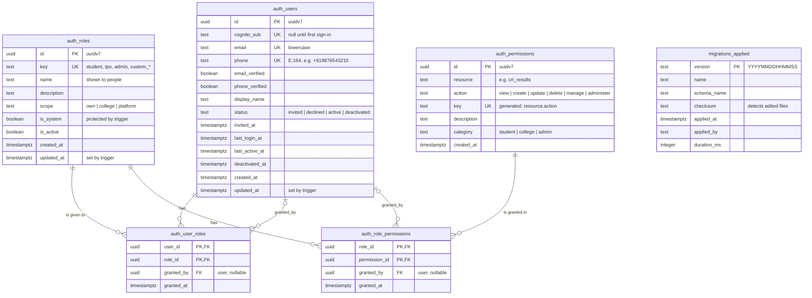
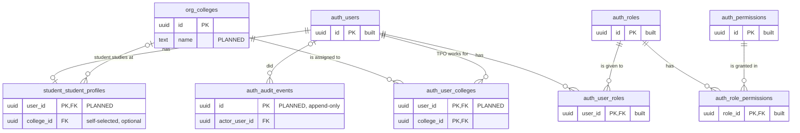

# Database

Metadamen uses **one Postgres database** called `metadamen`, with **one schema per module**.
Every table is created by a migration in
[`metadamen-packages/packages/db-postgres/migrations`](https://github.com/metadamen-ai-career-os/metadamen-packages/tree/main/packages/db-postgres/migrations).

> **Source of truth:** the migration files. This page shows the database as of **2026-10-13**.
> When you add a migration that changes a table, update this page in the same week.

---

## Schemas

| Schema | Holds | Owned by service | Status |
|---|---|---|---|
| `auth` | Users, roles, permissions | backend | ✅ Built |
| `org` | Colleges | backend | 🟡 Schema created, no tables yet |
| `student` | Student profiles and their college | backend | 🟡 Schema created, no tables yet |
| `migrations` | Log of applied migrations | migration runner | ✅ Built |

---

## Entity relationship diagram: built today



Table names in the diagram use `_` instead of `.`, so `auth_users` is the table `auth.users`.

### What each table is for

| Table | One row per | Key rules |
|---|---|---|
| `auth.users` | Person who has signed in, or was invited by an Admin | Needs an email **or** a phone. `cognito_sub` is empty only while `invited` or `declined`. Passwords are never stored here (login is handled by AWS Cognito). |
| `auth.roles` | Named bundle of permissions | `key` never changes. System roles (`student`, `tpo`, `admin`) can't be deleted. Roles made by Admins must start with `custom_`. |
| `auth.permissions` | Thing someone may be allowed to do | Named `<resource>.<action>`, e.g. `cri_results.view`. Only added by migrations. |
| `auth.role_permissions` | Role ↔ permission pair | Never updated, only added or removed. |
| `auth.user_roles` | User ↔ role pair | A user can have several roles. Their permissions are all their active roles' permissions together. |
| `migrations.applied` | Migration that has run | Written by the migration runner, never by hand. |

### Seed data (added by migrations)

| Role | Scope | Permissions | Who |
|---|---|---|---|
| `student` | `own`: their own data | 16 | Everyone who signs up |
| `tpo` | `college`: their assigned colleges | 10 | Training & Placement Officers, invited by an Admin |
| `admin` | `platform`: everything | 31 | Metadamen staff, invited by an Admin |

There are **40 permissions** in total, in three categories: `student`, `college` and `admin`.
To see them all:

```sql
select category, key, description from auth.permissions order by category, key;
```

---

## Entity relationship diagram: planned next

These tables are **agreed but not built yet**. Column lists will be decided in each table's pull request,
so only the keys and links are shown.



| Planned table | Why |
|---|---|
| `org.colleges` | The list of colleges students and TPOs belong to |
| `auth.user_colleges` | Which colleges a TPO may see (this is what the `college` scope means) |
| `student.student_profiles` | A student's profile and their college, picked at onboarding |
| `auth.audit_events` | Append-only log of who did what (role changes, invitations, deactivations) |

---

## Database users

Each service connects as **its own user**, so a bug in one service can't touch another service's data.

| User | Used by | Can do |
|---|---|---|
| `postgres` | You, for local admin work only | Everything. **Never used by apps.** |
| `migrator` | Migrations (`npm run db:migrate`) | Create and change schemas and tables |
| `backend_svc` | `metadamen-backend-svc` | Read and write `auth`, `org`, `student` |
| `notification_svc` | `metadamen-notification-svc` | Its own `notification` schema only (planned) |
| `llm_svc` | `metadamen-llm-svc` | Its own `llm` schema only (planned) |
| `reporting_ro` | Reports and analytics | **Read-only** on `auth`, `org`, `student` |

---

## Rules

1. **Change the database only through migrations.** Never by hand, not even locally.
2. **Never edit a migration that has run.** Add a new one instead.
3. **A migration only changes its own schema.** Foreign keys may point to another schema only if the **same service** owns both.
4. **Services never read another service's schema.** The owning service sends the data they need.

Full rules: [metadamen-packages README → Migrations](https://github.com/metadamen-ai-career-os/metadamen-packages#migrations)

---

## Look at the database yourself

With the local environment running ([setup guide](../getting-started/local-setup.md)):

```bash
cd metadamen-tooling
npm run db:psql
```

Then, at the `metadamen=#` prompt:

| Command | Shows |
|---|---|
| `\dn` | All schemas |
| `\dt auth.*` | Tables in `auth` |
| `\d auth.users` | Columns, constraints and triggers of one table |
| `select * from migrations.applied order by version;` | Which migrations have run |
| `\q` | Quit |
