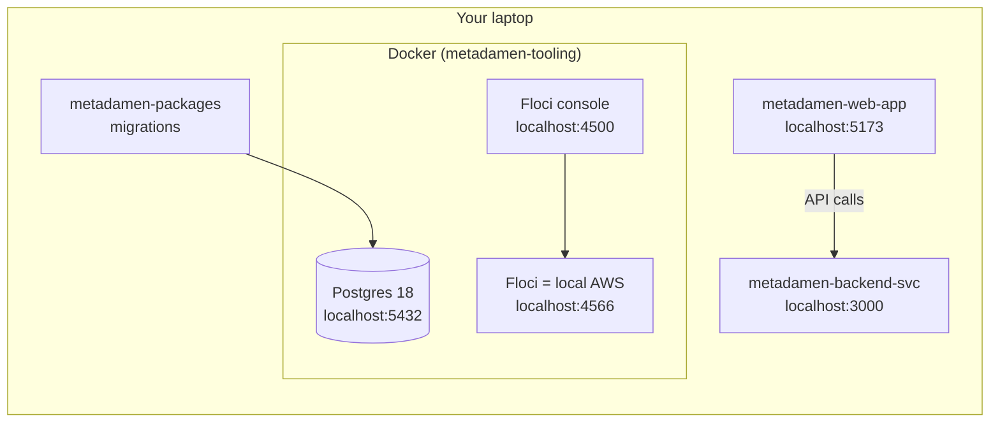

# Set up your local environment

This guide takes you from a fresh **Mac or Windows** laptop to a running Metadamen development environment.
It covers **what** to set up and in **which order**. Each repo's own `README.md` has the details.

**Time needed:** about 45 minutes (most of it is downloads).

Where macOS and Windows differ, the steps show both. On Windows, use **PowerShell** for every command.

New to the system? Read the [Architecture overview](../architecture/overview.md) first. It takes five minutes.

---

## Contents

1. [Minimum system requirements](#1-minimum-system-requirements)
2. [Software to install](#2-software-to-install)
3. [Get access to GitHub](#3-get-access-to-github)
4. [Clone the repos](#4-clone-the-repos)
5. [Start Postgres and local AWS](#5-start-postgres-and-local-aws-metadamen-tooling)
6. [Log in to GitHub Packages](#6-log-in-to-github-packages-one-time)
7. [Set up the shared libraries and database](#7-set-up-the-shared-libraries-and-database-metadamen-packages)
8. [Run the backend API](#8-run-the-backend-api-metadamen-backend-svc)
9. [Run the web app](#9-run-the-web-app-metadamen-web-app)
10. [AWS infrastructure (only if you deploy)](#10-aws-infrastructure-metadamen-infra-only-if-you-deploy)

---

## What you'll end up with



```
metadamen/                   one folder, all repos side by side
├── metadamen-tooling        Postgres + local AWS (Floci) in Docker
├── metadamen-packages       Shared libraries (logger, db-postgres) and database migrations
├── metadamen-backend-svc    Main API (AWS Lambda handlers + a local dev server)
├── metadamen-web-app        React web app
└── metadamen-infra          AWS infrastructure (CDK). Only needed if you deploy
```

The notification and LLM services and the public website don't have code yet. This guide will cover them once they do.

---

## 1. Minimum system requirements

|  | Minimum | Recommended |
|---|---|---|
| **macOS** | macOS 14 Sonoma, Apple silicon (M1 or newer) or Intel | Latest macOS, Apple silicon |
| **Windows** | Windows 10 22H2 (64-bit) or Windows 11, with **WSL 2** | Windows 11 |
| **Memory (RAM)** | 8 GB | 16 GB |
| **Free disk space** | 20 GB | 40 GB |
| **CPU** | 64-bit, 4 cores, **virtualization turned on** | 8 cores |
| **Network** | Internet access to github.com, npmjs.org and Docker Hub | — |
| **Accounts** | A GitHub account added to `metadamen-ai-career-os` | — |

Docker runs Postgres and Floci in a small virtual machine. That's why it needs virtualization and most of the memory.

**Windows: check virtualization is on.** Open **Task Manager → Performance → CPU**. "Virtualization" must say **Enabled**.
If it says Disabled, turn it on in your laptop's BIOS/UEFI settings (search for "Intel VT-x" or "AMD-V" plus your laptop model).

---

## 2. Software to install

| Software | Version | Why | macOS | Windows |
|---|---|---|---|---|
| **Git** | 2.40+ | Download and save code | Comes with Xcode tools: `xcode-select --install` | [Git for Windows](https://git-scm.com/download/win) |
| **Node.js** | **24.x** | Runs every repo | via [nvm](https://github.com/nvm-sh/nvm) | via [nvm-windows](https://github.com/coreybutler/nvm-windows/releases) |
| **npm** | **11.x** | Installs packages, runs commands | Comes with Node 24 | Comes with Node 24 |
| **Docker Desktop** (or [OrbStack](https://orbstack.dev) on Mac) | Docker 28+, Compose v2 | Runs Postgres and Floci | [Docker Desktop for Mac](https://docs.docker.com/desktop/setup/install/mac-install/) | [Docker Desktop for Windows](https://docs.docker.com/desktop/setup/install/windows-install/), **WSL 2 backend** |
| **Code editor** | any | Write code | [VS Code](https://code.visualstudio.com) recommended | [VS Code](https://code.visualstudio.com) recommended |
| **VS Code extensions** | latest | Format on save, matching our rules | Biome (`biomejs.biome`), Markdown Preview Mermaid Support | same |
| **AWS CLI** | v2 | **Only for `metadamen-infra`** (deploying) | [AWS CLI for Mac](https://docs.aws.amazon.com/cli/latest/userguide/getting-started-install.html) | [AWS CLI for Windows](https://docs.aws.amazon.com/cli/latest/userguide/getting-started-install.html) |
| **Database client** (optional) | any | Browse tables with a UI | pgAdmin, DBeaver or TablePlus | pgAdmin or DBeaver |

You do **not** need to install Postgres or a real AWS account for development. Docker runs both.

Docker Desktop is free for small companies. Larger companies need a paid plan; check [Docker's terms](https://www.docker.com/pricing/) if unsure.

### 2.1 Git

**Windows only:** stop Git from changing line endings. Run this **before cloning anything**:

```powershell
git config --global core.autocrlf input
```

Without it, Git for Windows converts files to Windows line endings. The local AWS setup script then fails inside Docker,
and the formatter reports every file as changed.

Then set your name and email (macOS and Windows):

```bash
git config --global user.name "Your Name"
```

```bash
git config --global user.email "you@metadamen.com"
```

### 2.2 Node.js 24 and npm 11

Every repo has `engine-strict=true` in its `.npmrc`, so `npm install` **refuses to run** on the wrong Node or npm version.
That's on purpose: everyone runs the same versions.

**macOS**: install [nvm](https://github.com/nvm-sh/nvm#installing-and-updating), open a new terminal, then:

```bash
nvm install 24
```

**Windows**: uninstall any Node.js you already have, install [nvm-windows](https://github.com/coreybutler/nvm-windows/releases) (`nvm-setup.exe`),
then open **PowerShell as Administrator**:

```powershell
nvm install 24
```

```powershell
nvm use 24
```

**Check (both):**

```bash
node --version
```

```bash
npm --version
```

You should see `v24.x.x` and `11.x.x`.

### 2.3 Docker

**macOS**: install Docker Desktop (or OrbStack) and open it.

**Windows**:

1. Install WSL 2 from **PowerShell as Administrator**, then restart:

   ```powershell
   wsl --install
   ```

2. Install Docker Desktop. During setup keep **"Use WSL 2 instead of Hyper-V"** ticked.
3. Open Docker Desktop and wait until it says **Engine running**.

**Check (both).** Docker must be **running**, not just installed:

```bash
docker ps
```

```bash
docker compose version
```

If it says _"Cannot connect to the Docker daemon"_ or _"error during connect"_, open Docker Desktop and wait until it has started.

**Give Docker enough memory:** in Docker Desktop → **Settings → Resources**, set at least **4 GB** memory.
(On Windows with WSL 2, Docker uses WSL's memory automatically.)

---

## 3. Get access to GitHub

All repos live in the private GitHub organization **`metadamen-ai-career-os`**.

1. Ask an admin to add your GitHub account to the organization, and accept the email invitation.
2. Create an SSH key and add it to GitHub. Follow GitHub's guide for your system:
   [generate a key](https://docs.github.com/en/authentication/connecting-to-github-with-ssh/generating-a-new-ssh-key-and-adding-it-to-the-ssh-agent),
   then [add it to GitHub](https://docs.github.com/en/authentication/connecting-to-github-with-ssh/adding-a-new-ssh-key-to-your-github-account).
3. Check it works:

   ```bash
   ssh -T git@github.com
   ```

   It should say _"Hi &lt;your-username&gt;! You've successfully authenticated"_.

---

## 4. Clone the repos

Keep all repos side by side in one folder.

**macOS**:

```bash
mkdir -p ~/metadamen
```

```bash
cd ~/metadamen
```

**Windows**:

```powershell
New-Item -ItemType Directory -Force "$HOME\metadamen"
```

```powershell
cd "$HOME\metadamen"
```

> **Windows:** keep the folder on a short path like `C:\Users\<you>\metadamen`. Avoid OneDrive folders (such as Documents
> or Desktop): syncing slows down `npm install` and can lock files.

**Both:**

```bash
git clone git@github.com:metadamen-ai-career-os/metadamen-tooling.git
```

```bash
git clone git@github.com:metadamen-ai-career-os/metadamen-packages.git
```

```bash
git clone git@github.com:metadamen-ai-career-os/metadamen-backend-svc.git
```

```bash
git clone git@github.com:metadamen-ai-career-os/metadamen-web-app.git
```

```bash
git clone git@github.com:metadamen-ai-career-os/metadamen-infra.git
```

---

## 5. Start Postgres and local AWS (`metadamen-tooling`)

This repo starts everything the services need in Docker, so you never install Postgres by hand or use a real AWS account for development.

**Check ports 5432, 4566, 4500, 3000 and 5173 are free.** No output means they're free.
(3000 is for the backend API and 5173 for the web app, later in this guide.)

macOS:

```bash
lsof -i :5432 -i :4566 -i :4500 -i :3000 -i :5173
```

Windows:

```powershell
Get-NetTCPConnection -LocalPort 5432,4566,4500,3000,5173 -State Listen -ErrorAction SilentlyContinue
```

If something is using them (often a locally installed Postgres), stop it, or change the ports: copy `.env.example`
to `.env` in `metadamen-tooling` and edit `POSTGRES_PORT`, `FLOCI_PORT` or `FLOCI_UI_PORT`.

**Start everything:**

```bash
cd metadamen-tooling
```

```bash
npm run docker:up
```

The first run downloads about 1 GB of images and takes a few minutes. There is no `npm install` here; the repo has no dependencies.

**Create the AWS resources (queues, ...) inside Floci:**

```bash
npm run floci:init
```

Each resource is printed with a ✅.

**Check it works:**

```bash
npm run docker:ps
```

`metadamen-postgres` and `metadamen-floci` should show **`(healthy)`**.

```bash
npm run db:psql
```

This opens a Postgres prompt (`metadamen=#`). Type `select version();` and press Enter. It should print `PostgreSQL 18.x ...`.
Type `\q` to leave.

Then open the Floci console at [http://localhost:4500](http://localhost:4500).

| What | Address | Login |
|---|---|---|
| Postgres | `localhost:5432`, database `metadamen` | Each service has its own user; password = user name (local only). See [Database users](../database/erd.md#database-users) |
| Floci (local AWS) | `http://localhost:4566` | Access key `test`, secret `test`, region `ap-south-1` |
| Floci console | [http://localhost:4500](http://localhost:4500) | None |

More details: [metadamen-tooling README](https://github.com/metadamen-ai-career-os/metadamen-tooling#readme)

---

## 6. Log in to GitHub Packages (one time)

Our shared libraries (`@metadamen-ai-career-os/logger`, `@metadamen-ai-career-os/db-postgres`, ...) are published
privately to **GitHub Packages**. npm needs a token to download them.

1. On GitHub: **Settings → Developer settings → Personal access tokens → Tokens (classic) → Generate new token (classic)**.
2. Tick only the **`read:packages`** scope, pick an expiry, and create it. Copy the token.
3. Log in to npm with it:

   ```bash
   npm login --scope=@metadamen-ai-career-os --auth-type=legacy --registry=https://npm.pkg.github.com
   ```

   - **Username:** your GitHub username
   - **Password:** paste the token (not your GitHub password)

The token is saved in your own `.npmrc` in your home folder, never in a repo. Never commit or share it.
When it expires, create a new one and run the login again.

---

## 7. Set up the shared libraries and database (`metadamen-packages`)

From your `metadamen` folder:

```bash
cd metadamen-packages
```

```bash
npm install
```

```bash
cp .env.example .env
```

`npm install` also installs the git hooks. `.env` already points at the Postgres from step 5.

**Check the database connection:**

```bash
npm run db:ping
```

It should print the user, the database and the Postgres version.

**Create all the tables:**

```bash
npm run db:migrate
```

This runs the migrations as the `migrator` user. Run it again whenever you pull new migrations; it only applies new ones.
To see what was created, read [Database](../database/erd.md).

More details: [metadamen-packages README](https://github.com/metadamen-ai-career-os/metadamen-packages#readme)

---

## 8. Run the backend API (`metadamen-backend-svc`)

From your `metadamen` folder:

```bash
cd metadamen-backend-svc
```

```bash
npm install
```

```bash
npm run dev
```

It prints `Dev server running on http://localhost:3000`. Leave it running; it restarts by itself when you save a file.
Open [http://localhost:3000/health](http://localhost:3000/health) in your browser. You should see:

```json
{"data":{"status":"ok","message":"Metadamen API is healthy"}}
```

The repo's `.npmrc` makes npm fetch `@metadamen-ai-career-os/*` packages from GitHub Packages, using the login from step 6.

More details: [Backend service](../services/backend-svc.md)

---

## 9. Run the web app (`metadamen-web-app`)

From your `metadamen` folder:

```bash
cd metadamen-web-app
```

```bash
npm install
```

```bash
npm run dev
```

Open the address it prints: [http://localhost:5173](http://localhost:5173). Press `Ctrl+C` to stop.

Keep the web app on port **5173**: it's the only address the backend API accepts browser calls from (CORS).
If Vite picks another port because 5173 is busy, stop whatever is using 5173 and start it again.

More details: [metadamen-web-app README](https://github.com/metadamen-ai-career-os/metadamen-web-app#readme)

---

## 10. AWS infrastructure (`metadamen-infra`), only if you deploy

You don't need this for local development. If you will deploy to AWS, from your `metadamen` folder:

```bash
cd metadamen-infra
```

```bash
npm install
```

```bash
npm test
```

`npm test` checks the infrastructure code without AWS access. To deploy, you need AWS CLI v2 and credentials from an admin.
See the [metadamen-infra README](https://github.com/metadamen-ai-career-os/metadamen-infra#readme).

---

## You're done when

- [ ] `node --version` shows `v24.x` and `npm --version` shows `11.x`
- [ ] `npm run docker:ps` in `metadamen-tooling` shows Postgres and Floci as **healthy**
- [ ] [http://localhost:4500](http://localhost:4500) shows the Floci console
- [ ] `npm run db:ping` in `metadamen-packages` prints the Postgres version
- [ ] `npm run db:migrate` finishes without errors
- [ ] [http://localhost:3000/health](http://localhost:3000/health) shows `"status":"ok"`
- [ ] The web app opens at [http://localhost:5173](http://localhost:5173)

---

## Daily routine

| When | Where | Command |
|---|---|---|
| Start of the day | `metadamen-tooling` | `npm run docker:up` |
| After `git pull` in any repo | that repo | `npm install` |
| After pulling new migrations | `metadamen-packages` | `npm run db:migrate` |
| While coding the API | `metadamen-backend-svc` | `npm run dev` (leave it running) |
| While coding the web app | `metadamen-web-app` | `npm run dev` (leave it running) |
| End of the day (optional, data is kept) | `metadamen-tooling` | `npm run docker:down` |

---

## Rules that apply in every repo

- **Commit messages** follow [Conventional Commits](https://www.conventionalcommits.org/): `feat: add login page`, `fix(db-postgres): close pool on shutdown`.
  A git hook rejects any other format.
- **Before every commit**, a git hook runs `npm run check` (format, lint, typecheck) and `npm test`. If it fails, fix the problem; don't skip the hook.
- **Formatting and linting** use [Biome](https://biomejs.dev). We don't use ESLint or Prettier.
- **Never commit secrets.** `.env` files are git-ignored; only `.env.example` (no real secrets) is committed.
- **One branch and one pull request per change.** Never push straight to `main`.

---

## Troubleshooting

| Problem | System | Fix |
|---|---|---|
| `npm install` fails with `Unsupported engine` / `EBADENGINE` | both | Wrong Node or npm version. Run `nvm use 24`, then check `node --version` |
| `nvm use 24` says "exit status 1" or access denied | Windows | Run PowerShell **as Administrator** |
| `Cannot connect to the Docker daemon` / `error during connect` | both | Open Docker Desktop and wait until the engine is running |
| Docker Desktop says WSL 2 is missing or out of date | Windows | Run `wsl --update` as Administrator, then restart |
| Docker Desktop says virtualization is disabled | Windows | Turn on VT-x / AMD-V in the BIOS (see [requirements](#1-minimum-system-requirements)) |
| `port is already allocated` / `address already in use` | both | Port 5432, 4566 or 4500 is taken. See step 5 |
| `npm run floci:init` fails with `$'\r': command not found` | Windows | Line endings were converted. Run `git config --global core.autocrlf input`, delete `metadamen-tooling`, and clone it again |
| `npm run check` reformats files you didn't touch | Windows | Same line-ending problem: fix as above and clone the repo again |
| `npm install` fails with `401 Unauthorized` or `404` for `@metadamen-ai-career-os/...` | both | Not logged in to GitHub Packages, or the token expired or lacks `read:packages`. Repeat step 6 |
| `git clone` says `Permission denied (publickey)` or `Repository not found` | both | SSH key missing, or you haven't joined the GitHub organization yet. See step 3 |
| Web app shows a **CORS error** calling the API | both | The web app isn't on `http://localhost:5173`. Free port 5173 and restart `npm run dev` |
| `npm run dev` in the backend says `EADDRINUSE` | both | Port 3000 is taken. Stop the other program, or the other `npm run dev` you left open |
| `db:ping` / `db:migrate` can't connect | both | Postgres isn't running. Run `npm run docker:up` in `metadamen-tooling` |
| `npm install` is very slow or fails with `EPERM` / `EBUSY` | Windows | The folder is inside OneDrive, or antivirus is scanning it. Move it to `C:\Users\<you>\metadamen` |
| Local database is in a strange state | both | In `metadamen-tooling`: `npm run docker:reset` (⚠️ deletes all local data), then `npm run floci:init`. Then `npm run db:migrate` in `metadamen-packages` |

Still stuck? Ask in the team channel and include your system (macOS or Windows), the command you ran and the full error message.
