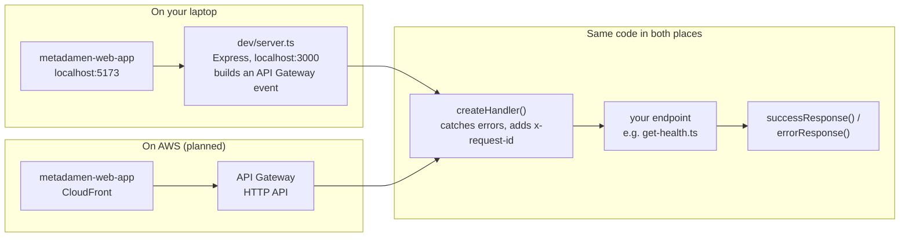

# Backend service (`metadamen-backend-svc`)

The main Metadamen API. Each endpoint is an **AWS Lambda function** behind **API Gateway**.
On your laptop, a small Express server calls the same functions, so you don't need AWS to develop.

> **Status (2026-10-17):** project set up, with one endpoint, `GET /health`. Sign-in, roles, colleges and students come next.
> Repo: [metadamen-backend-svc](https://github.com/metadamen-ai-career-os/metadamen-backend-svc)

---

## How a request flows

The handler code is the same in both places. Only what sits in front of it changes.



- **Locally**, `dev/server.ts` turns each Express request into the event API Gateway would send, calls the real handler,
  and turns the result back into an HTTP response.
- **On AWS**, API Gateway calls the handler directly. Each endpoint is built into its own small file in `dist/` and deployed as its own Lambda function.
  The AWS side (API Gateway, Lambda) will be created by `metadamen-infra`; it doesn't exist yet.

---

## Run it locally

Needs the [local setup](../getting-started/local-setup.md) done first (Node 24, npm 11, GitHub Packages login).

```bash
cd metadamen-backend-svc
```

```bash
npm install
```

```bash
npm run dev
```

It prints `Dev server running on http://localhost:3000` and restarts by itself when you save a file. Check it:

```bash
curl -i http://localhost:3000/health
```

You should get `200 OK` with:

```json
{ "data": { "status": "ok", "message": "Metadamen API is healthy" } }
```

On Windows PowerShell, `curl` is a different program. Use `curl.exe -i http://localhost:3000/health`, or open the address in your browser.

---

## Commands

| Command | What it does |
|---|---|
| `npm run dev` | Start the local API on `http://localhost:3000`; restarts when you save |
| `npm test` | Run the tests (Vitest) |
| `npm run test:watch` | Run the tests again on every save |
| `npm run check` | Format, lint (Biome) and typecheck |
| `npm run build` | Bundle each Lambda handler into `dist/<name>/index.mjs` (esbuild) |

Before every commit, a git hook runs `npm run check` and `npm test`.
CI runs the same on every pull request, plus `npm run build`. On `main` it saves `dist/` as the **`backend-lambdas`** build, kept for 10 days, ready for a deploy workflow.

---

## Project structure

```
metadamen-backend-svc/
├── src/
│   ├── modules/                    one folder per feature
│   │   └── health/
│   │       ├── handlers/
│   │       │   └── get-health.ts   one file per endpoint = one Lambda function
│   │       └── health.types.ts     the data types this module returns
│   ├── utils/
│   │   ├── create-handler.ts       wraps every endpoint (errors, request ID)
│   │   └── response.ts             successResponse() and errorResponse()
│   └── constants/
│       ├── error-codes.ts          every error code and its HTTP status
│       └── http-headers.ts         headers sent with every response
├── dev/
│   └── server.ts                   local Express server, never deployed
├── tests/                          mirrors src/, e.g. tests/modules/health/...
│   └── helpers/api-event.ts        builds fake API Gateway events for tests
└── .npmrc                          where to find @metadamen-ai-career-os packages
```

**Naming:** files and folders are `kebab-case`. A handler file is named `<method>-<thing>.ts`, e.g. `get-health.ts`, `post-invitation.ts`.

---

## Response format

**Every** response is JSON in one of two shapes, so the web app handles all endpoints the same way.

**Success (2xx):**

```json
{
  "data": { "status": "ok", "message": "Metadamen API is healthy" },
  "meta": { "page": 1 }
}
```

`meta` is optional (for example, paging details).

**Error (4xx / 5xx):**

```json
{
  "error": {
    "code": "NOT_FOUND",
    "message": "College not found",
    "details": { "collegeId": "..." }
  }
}
```

`details` is optional. `message` is for people; the web app decides what to do from `code`.

In code, never build a response by hand. Use the helpers in `src/utils/response.ts`:

```ts
return successResponse<HealthStatus>({ status: "ok", message: "Metadamen API is healthy" });
return successResponse<College>(college, 201);           // 200 (default), 201 or 202
return errorResponse("NOT_FOUND", "College not found");   // the status comes from the code
```

### Error codes

The HTTP status always follows from the code (`src/constants/error-codes.ts`).
**Add new codes freely, but never rename or remove one**: the web app depends on them.

| Code | Status | Use when |
|---|---|---|
| `BAD_REQUEST` | 400 | The request is malformed (bad JSON, wrong type) |
| `VALIDATION_FAILED` | 400 | Fields fail validation; put which ones in `details` |
| `UNAUTHORIZED` | 401 | No login token, or it isn't valid |
| `TOKEN_EXPIRED` | 401 | The login token has expired; the app should refresh it |
| `FORBIDDEN` | 403 | Logged in, but lacks the permission |
| `ACCOUNT_DEACTIVATED` | 403 | The user's account is deactivated |
| `NOT_FOUND` | 404 | The thing doesn't exist, or the user may not know it exists |
| `METHOD_NOT_ALLOWED` | 405 | Wrong HTTP method for this path |
| `CONFLICT` | 409 | Clashes with existing data (e.g. email already used) |
| `GONE` | 410 | Existed but is gone for good (e.g. an expired invitation) |
| `PRECONDITION_FAILED` | 412 | Someone else changed it first |
| `PAYLOAD_TOO_LARGE` | 413 | Upload or body too big |
| `UNSUPPORTED_MEDIA_TYPE` | 415 | Body isn't JSON (or the expected file type) |
| `BUSINESS_RULE_VIOLATION` | 422 | Valid request, but a rule forbids it (e.g. removing the last Admin) |
| `TOO_MANY_REQUESTS` | 429 | Rate limit hit |
| `INTERNAL_SERVER_ERROR` | 500 | A bug on our side. Sent automatically for anything thrown |
| `NOT_IMPLEMENTED` | 501 | The endpoint exists but isn't built yet |
| `UPSTREAM_ERROR` | 502 | A service we depend on (Cognito, LLM provider) answered with an error |
| `SERVICE_UNAVAILABLE` | 503 | Temporarily down; retry later |
| `UPSTREAM_TIMEOUT` | 504 | A service we depend on didn't answer in time |

### Headers on every response

| Header | Value | Why |
|---|---|---|
| `content-type` | `application/json` | Every body is JSON |
| `cache-control` | `no-store` | Responses can contain personal data, so nothing may cache them |
| `x-content-type-options` | `nosniff` | Browsers must trust our content type and never guess |
| `x-request-id` | the API Gateway request ID | Quote it in bug reports: it finds the request in the logs |

---

## Errors you don't catch

Every handler is wrapped in `createHandler()`. If your code throws anything:

1. The full error is logged with the request ID and route (only in the logs, never sent to the user).
2. The user gets `500 INTERNAL_SERVER_ERROR` with *"Something went wrong. Please try again."*

So **don't wrap whole handlers in try/catch**. Only catch errors you can turn into a better answer (for example, a unique-key clash becomes `CONFLICT`).

---

## Add an endpoint

Example: `GET /colleges`.

1. **Types:** `src/modules/colleges/colleges.types.ts` with the data it returns.
2. **Handler:** `src/modules/colleges/handlers/get-colleges.ts`:

   ```ts
   import { createHandler } from "../../../utils/create-handler.js";
   import { successResponse } from "../../../utils/response.js";
   import type { College } from "../colleges.types.js";

   export const handler = createHandler(async (event) => {
     const colleges: College[] = []; // load them here
     return successResponse<College[]>(colleges);
   });
   ```

   Imports end in `.js`, even though the files are `.ts`. Node needs that for ES modules.
3. **Local route:** add it to `dev/server.ts`, the same way as `/health`.
4. **Build:** add the handler to the `build` script in `package.json`, so it gets its own `dist/<module>-<handler>/index.mjs`.
5. **Test:** `tests/modules/colleges/handlers/get-colleges.test.ts`, using `apiEvent("GET", "/colleges")` from `tests/helpers/api-event.ts`.
6. **On AWS:** add the route and Lambda in `metadamen-infra` (once the API stack exists).

---

## CORS (which websites may call the API)

Only the web app may call the API from a browser.

| Where | Allowed origin | Set in |
|---|---|---|
| Local | `http://localhost:5173` (the web app's dev server) | `ALLOWED_ORIGINS` in `dev/server.ts` |
| AWS | The web app's CloudFront address for that stage | API Gateway, in `metadamen-infra` (planned) |

If the web app runs on another port and the browser shows a **CORS error**, that's why. Use port 5173.

---

## Shared packages

The repo's `.npmrc` already points `@metadamen-ai-career-os/*` packages at GitHub Packages, so installing them works like any other package
once you've done the one-time login:

```bash
npm install @metadamen-ai-career-os/logger
```

See [Shared packages](../guides/shared-packages.md) for the login, the database packages, and the change CI needs before the first one is installed.
